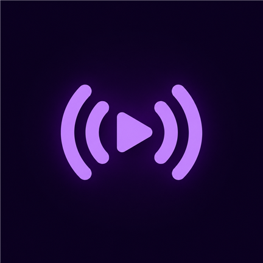
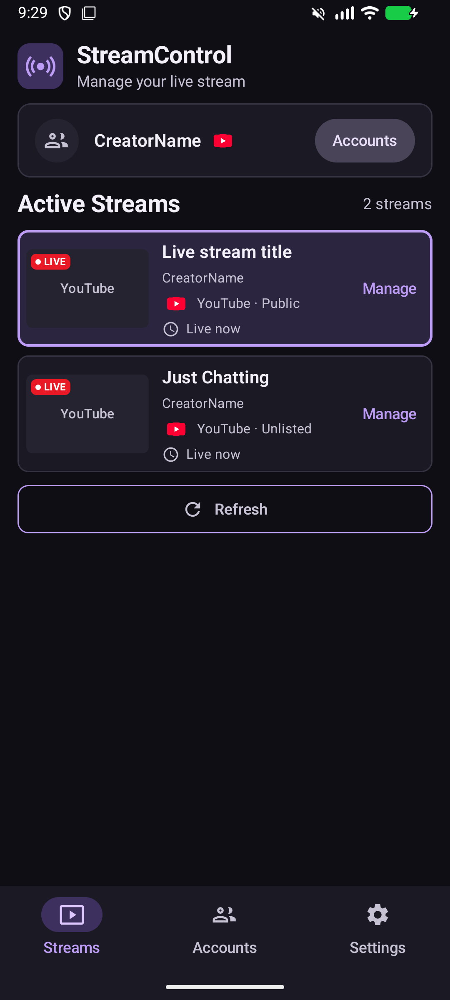
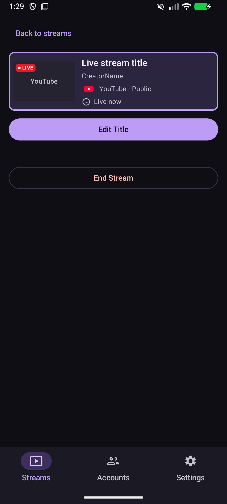
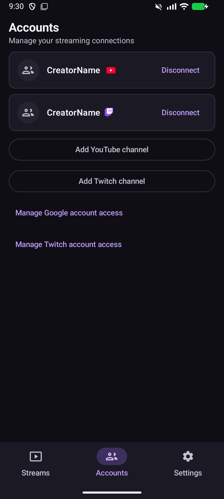

# Stream Controls

Stream Controls is an Android app for managing YouTube and Twitch livestreams from one place. Connect your channels, see which streams are live, and update their titles without opening each platform's dashboard.

**Status:** Stream Controls is in development. Prebuilt APKs will be available in [GitHub Releases](https://github.com/ron77950/StreamControls/releases).

## Screenshots

Example accounts and streams are shown.

  

## What it does

- Connect multiple YouTube and Twitch channels and see their active streams together.
- Edit a live stream's title, copy a title from another live stream, and save reusable title presets on your device.
- End a YouTube broadcast after confirmation.

Stream Controls cannot end Twitch streams; stop them in your streaming software.

Ending a YouTube broadcast doesn't necessarily stop your streaming software from sending video. Stop the encoder separately when needed.

## Requirements

- An Android phone or tablet running Android 8.0 (API 26) or later, with internet access.
- A YouTube or Twitch channel with permission to use its platform's API. YouTube livestreaming must be enabled on the channel to manage live broadcasts.
- Chrome is recommended for connecting accounts. Other browsers can work; YouTube sign-in requires one that supports Auth Tab.
- For a source build, Android Studio and the SDK components requested by the project. YouTube sign-in also needs a Google OAuth client configured for the build's signing certificate.

## Build and run

1. Open the repository in Android Studio and let it install or sync the required SDK components.
2. If you want YouTube support, follow the [Google OAuth setup guide](docs/GOOGLE_OAUTH_SETUP.md) to configure YouTube Data API access and the Android client ID for your signing certificate. A source build without this configuration cannot connect to YouTube.
3. Select an Android device in Android Studio and run the app.

The project includes a public Twitch client ID; no Twitch client secret is embedded in the app. If you publish a separate fork or application, review [Twitch setup](docs/TWITCH_SETUP.md) for registering and configuring your own client. See the [development guide](docs/DEVELOPMENT.md) for build commands and test details.

## Connecting accounts

Open **Accounts** in Stream Controls and choose a platform:

- **YouTube:** Sign in through Google, select the intended YouTube channel when prompted, and confirm the channel shown in Stream Controls. Google asks for permission to manage your YouTube account, which allows more than the stream management features this app uses. Access also depends on your channel's eligibility and permissions and the Google project's OAuth audience and verification status.
- **Twitch:** Open Twitch from the connection screen, sign in and approve access. Enter the displayed code if Twitch asks for it. Twitch asks for permission to manage your channel's broadcast configuration, which also covers settings and features beyond the title changes this app uses. After approval, return to Stream Controls to see the connected channel.

> [!IMPORTANT]
> YouTube sign-in for the release app is currently limited to approved testers. To use it, the developer must add your Google account email to the tester list. Google requires an app homepage on a verified domain as part of its OAuth verification process for wider public access. Twitch does not use this tester list.

> [!NOTE]
> Twitch may open its Android app after approval on some devices. If it shows a black screen, return to Stream Controls; the connection may already have succeeded. When permitted, Stream Controls can show a notification after the account connects. Notifications can be turned off in **Settings → Notifications** or in Android's settings.

## Using streams and presets

The Streams page loads connected channels' live streams when the app restores connections or a channel is connected. Switching tabs doesn't refresh the list. Use **Refresh** to check for changes; each connected channel may require separate API requests. Stream actions also make the requests needed to check and confirm the result. YouTube API quota applies.

Select a stream to manage it. YouTube titles can be up to 100 characters and cannot contain `<` or `>`; Twitch titles can be up to 140 characters. Presets are shared locally between platforms, and the selected platform's title rules apply when you use one. Thumbnails aren't always available, particularly for private streams, so a placeholder may appear.

## Privacy and security

Stream Controls communicates directly with Google, YouTube, and Twitch. It has no developer-operated backend, advertising, or analytics. Saved account credentials are encrypted and stored locally on your device. Presets and settings are also stored locally.

The permissions requested by YouTube and Twitch cover more than Stream Controls currently uses. Google's permission allows management of your YouTube account; Stream Controls uses it to find live broadcasts, change their titles, and end broadcasts you confirm. Twitch's permission allows management of broadcast configuration, including settings, stream markers, and tags; Stream Controls uses it to update stream titles.

Disconnecting removes the local connection and attempts to revoke provider access. If revocation fails, the app reports that the disconnect was local only. Google revocation may also affect other channels or clients associated with the same account and project. See the [security guide](docs/SECURITY.md) for details and limitations.

## Project documentation

- [Development](docs/DEVELOPMENT.md)
- [Google OAuth setup and troubleshooting](docs/GOOGLE_OAUTH_SETUP.md)
- [Twitch setup](docs/TWITCH_SETUP.md)
- [Security](docs/SECURITY.md)

## License

No license has been selected for the Stream Controls project. Third-party notices for included dependencies are available in the app.
